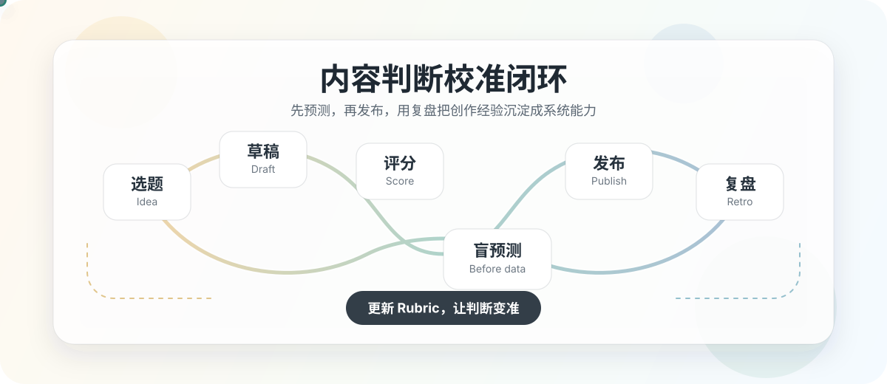

# Shuo's content OS

面向 AI 创作者、独立创业者和内容型产品团队的内容操作系统。

它不是一个普通模板库，而是一套把「选题、创作、发布、预测、复盘、校准」串起来的工作台。目标很简单：让每一次发布都变成下一次判断更准的训练数据。



> 这个仓库只公开系统结构、模板、工具和方法。真实账号、真实文稿、真实数据、真实对标、真实复盘、截图、cookie、token、session 和私有经验参数都不应该进入公开仓库。

## 它解决什么问题

大多数内容创作的问题，不是没有灵感，而是没有闭环。

很多人发布之后只看数据，靠感觉总结，然后很快忘记自己发布前到底判断了什么。这样做久了，经验会越来越多，但判断不一定越来越准。

Shuo's content OS 想解决的是这件事：

```text
选题 -> 草稿 -> 评分 -> 盲预测 -> 发布 -> 复盘 -> 更新 Rubric
```

先写下判断，再接受真实数据校验。被验证的观察进入规则，被推翻的观察降级或删除。长期下来，你积累的不是一堆内容文件，而是一套越来越准的内容判断系统。

## 系统如何工作

1. **选题进入候选池**
   把灵感变成可比较、可排序、可复盘的候选项。

2. **用 Rubric 评分**
   不靠临场感觉拍脑袋，而是用固定维度检查内容的传播潜力和表达风险。

3. **发布前写盲预测**
   在真实数据出现前，记录你对播放、阅读、互动或转化的判断。

4. **发布后登记数据**
   把真实表现写入系统，而不是只在平台后台看一眼。

5. **T+N 复盘**
   比较预测和现实的偏差，找到判断失准的原因。

6. **更新 Rubric**
   只把经过验证的经验沉淀为规则，让系统持续进化。

## 目录结构

```text
00-项目入口-entry
  看板、操作指南、工作流、状态记录

01-产品本体-product-core
  产品定义、卖点定位、素材边界

02-市场与竞品-market-research
  竞品研究、对标账号、市场判断

03-内容与销售-content-sales
  平台账号模板、发布清单、复盘数据、素材库

04-创作流水线-creation-pipeline
  草稿、样本、已拍视频、内容生产过程

05-校准与复盘-calibration-retro
  评分系统、预测日志、复盘记录、受众画像

06-系统引擎-system-engine
  CLI 工具、模板、schema、适配器、共享规范

99-原始资料-raw-materials
  原始导出和临时资料占位，不放真实私有材料
```

## 快速开始

需要：

- Python 3.10+
- Git

克隆仓库：

```bash
git clone https://github.com/ChenShuo2004/Shuo-s-content-OS.git
cd "Shuo-s-content-OS"
```

初始化一个私有内容工作区。建议放在公开仓库外面：

```bash
python "06-系统引擎-system-engine/工具-tools/content_os.py" init "../我的私有内容项目"
python "06-系统引擎-system-engine/工具-tools/content_os.py" status "../我的私有内容项目"
```

创建一篇草稿：

```bash
python "06-系统引擎-system-engine/工具-tools/content_os.py" new-script "../我的私有内容项目" "第一篇内容标题"
```

写发布前盲预测：

```bash
python "06-系统引擎-system-engine/工具-tools/content_os.py" predict "../我的私有内容项目" "scripts/<文件名>.md" \
  --bucket "1000-5000 views" \
  --center 2500 \
  --reason "问题清楚，但分发势能一般"
```

登记发布：

```bash
python "06-系统引擎-system-engine/工具-tools/content_os.py" publish "../我的私有内容项目" "predictions/<文件名>.md" \
  --platform x \
  --url "https://example.com/fake-post"
```

追加复盘：

```bash
python "06-系统引擎-system-engine/工具-tools/content_os.py" retro "../我的私有内容项目" "predictions/<文件名>.md" \
  --views 3200 \
  --likes 88 \
  --comments 12 \
  --shares 6 \
  --notes "低估了标题的清晰度"
```

## 从这里开始读

- [操作指南](00-项目入口-entry/操作指南-OPERATION_GUIDE.md)
- [项目结构说明](00-项目入口-entry/项目结构说明-STRUCTURE.md)
- [工作流速查](00-项目入口-entry/WORKFLOW.md)
- [隐私与开源边界](00-项目入口-entry/文档-docs/privacy-model.md)
- [GitHub 发布检查清单](00-项目入口-entry/文档-docs/github-release-checklist.md)

## 适合谁使用

- 想把内容创作产品化的 AI 创作者。
- 正在用内容验证商业想法的独立创业者。
- 想系统复盘选题、标题、脚本和分发效果的内容团队。
- 想让 AI Agent 参与选题、评分、预测和复盘的人。
- 不想把真实内容资产和公开方法论混在一起的人。

## 公开仓库安全边界

推送到 GitHub 前先跑：

```bash
python "06-系统引擎-system-engine/工具-tools/content_os.py" scan-public .
git status --short
```

再手动确认：

- 没有真实账号名、真实平台链接、真实评论。
- 没有真实发布清单、复盘数据、截图、导出文件。
- 没有 `.env`、cookie、token、session、API key、数据库。
- `04-创作流水线-creation-pipeline/样本-samples` 里只有虚构样例。
- `99-原始资料-raw-materials` 只保留说明，不放真实原始资料。

## 核心原则

### 公开结构，不公开资产

开源的是目录、模板、工具和方法；私有的是内容、数据、账号、判断经验和商业资产。

### 先预测，再看数据

预测必须写在真实数据出现之前。预测写完之后，只追加复盘，不回头改答案。

### 发布不是结束，复盘才是训练

每一次发布都应该结算一次判断偏差。系统真正变强的地方，不在发布按钮，而在复盘记录。

### Rubric 是工作台，不是教条

规则要被数据挑战。被验证的规则留下，被推翻的规则降级，模糊的观察继续观察。

## License

MIT. See [LICENSE](LICENSE).
